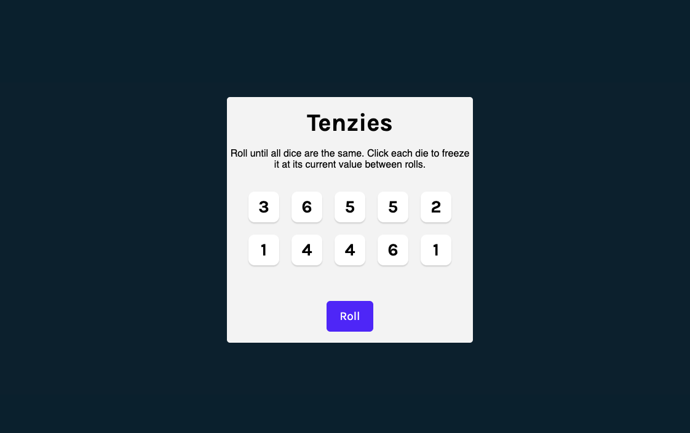

# Tenzies

A React implementation of the Tenzies dice game. Roll ten dice until they all show the same value. Click a die to hold it in place between rolls. Hold all dice with the same value to win.
<a href="https://tenzies-beta-seven.vercel.app/" target="_blank" rel="noopener noreferrer">Live Preview</a>



## Features

- Ten dice, each with a value and a held state
- Click any die to hold or release it between rolls
- Win detection when every die is held and shows the same value
- Confetti on win
- Focus moves to the "New Game" button when you win, so keyboard users can start a new round right away
- Screen reader announcement when the game is won

## Tech Stack

- [React 18](https://react.dev/)
- [Vite](https://vitejs.dev/)
- [nanoid](https://github.com/ai/nanoid) for unique die IDs
- [react-confetti](https://github.com/alampros/react-confetti) for the win animation

## Getting Started

### Prerequisites

- [Node.js](https://nodejs.org/) (version 18 or later)
- npm (included with Node.js)

### Installation

```bash
git clone https://github.com/huntertigert/tenzies.git
cd tenzies
npm install
```

### Running Locally

```bash
npm run dev
```

Then open the URL Vite prints, usually `http://localhost:5173`.

### Building for Production

```bash
npm run build
npm run preview
```

## How to Play

1. Click **Roll** to roll all dice.
2. Click a die to hold it. Held dice keep their value when you roll.
3. Keep rolling and holding until all ten dice show the same number.
4. Click **New Game** to play again.

## Project Structure
